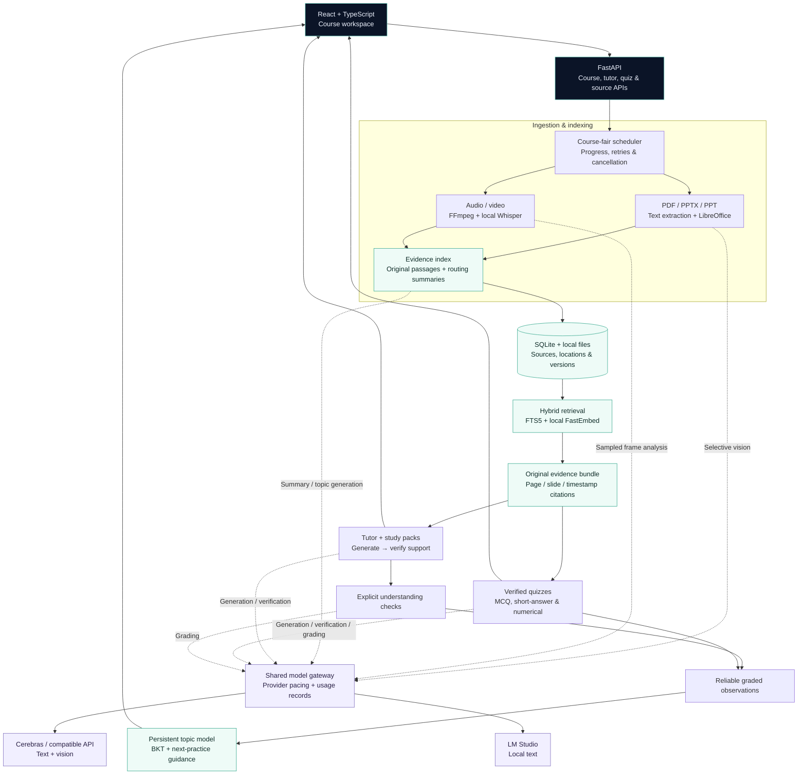

<p align="center">
  
</p>

<h1 align="center">Your course. Your evidence. Your next step.</h1>

<p align="center">
  PocketTA turns scattered lectures, slides, and PDFs into a personal TA that shows where answers come from<br />
  and uses your mistakes to guide what you practice next.
</p>

<p align="center">
  <strong>Source-cited tutoring · Verified assessments · Adaptive practice</strong><br />
  React + TypeScript · FastAPI · SQLite · Local Whisper + FastEmbed
</p>

<p align="center">
  <a href="#the-study-workflow">Explore the workflow</a> ·
  <a href="#architecture">Architecture</a> ·
  <a href="#evaluation">Evaluation</a> ·
  <a href="#prerequisites">Setup</a> ·
  <a href="docs/DEMO_RUN_SHEET.md">Demo walkthrough</a>
</p>

---

## Why PocketTA?

**“Where was this explained?”** and **“What should I study next?”** belong in the same study workflow.

PocketTA brings course material, cited explanations, assessment feedback, and saved learning history into one workspace. Open the page, slide, or recording timestamp behind an explanation; answer a check; then use the feedback to choose your next practice topic.

> **Evidence stays inspectable.** Tutor claims undergo a separate support check before publication. Ordinary conversation does not increase mastery, and topics with too little graded evidence show **insufficient evidence**.

## The study workflow

| Step | What you can do | What makes it useful |
|---|---|---|
| **1. Collect** | Upload PDFs, PPTX, legacy PPT, or lecture recordings; record a microphone or browser tab. | Course workspaces keep sources together, with page, slide, and timestamp provenance. |
| **2. Explore** | Search selected sources or generate a multi-source study pack. | Hybrid keyword and local semantic retrieval returns original evidence; notes, concepts, and flashcards link back to it. |
| **3. Ask** | Explain simply, give an example, compare concepts, or test understanding. | Claim-level verification checks cited excerpts; missing support can produce a refusal. |
| **4. Practice** | Start a baseline diagnostic or build MCQ, short-answer, and numerical quizzes. | Questions undergo separate verification; attempts autosave and feedback cites course evidence. |
| **5. Adapt** | Review weak topics, likely misconceptions, recent mistakes, and next steps. | Reliable grades update a persistent Bayesian Knowledge Tracing estimate with explicit evidence requirements. |

### Built for actual study sessions

- **Follow the citation:** open exact PDF pages and slides, or seek audio/video after its metadata loads.
- **Recover your work:** cancel, retry, and restore interrupted processing; resume saved quiz attempts and course chat.
- **Understand progress:** measured upload transfer is separate from extraction, transcription, indexing, and generation.
- **Inspect uncertainty:** low-confidence source units are excluded from reliable evidence; uncertain grades do not update mastery.
- **Choose processing boundaries:** local transcription, storage, and default embeddings; configurable cloud generation/vision or local text through LM Studio.
- **Keep useful outputs:** correct transcripts, export source study packs as Markdown, download learning reports, and print through the browser.

## Architecture

A course-based modular monolith: one React client, one FastAPI process, SQLite, local assets, and configurable model providers.



**Evidence contract:** summaries route retrieval; original passages support claims. Source membership, versions, locations, and uncertainty are revalidated before answers or grades are saved. Quiz answers and explicit tutor checks update mastery; ordinary chat records activity only.

**Model boundary:** transcription and storage stay local. FastEmbed runs on CPU after a one-time model download. Cloud generation and vision send relevant text/images to the configured endpoint. Paid embedding APIs require explicit opt-in with `EMBEDDING_PROVIDER=api`.

See [the architecture reference](ARCHITECTURE.md), [retrieval](docs/KNOWLEDGE.md), [tutor verification](docs/TUTOR.md), and [multi-source assessment](docs/MULTI_SOURCE.md) for implementation details.

## Evaluation

### DeepEval: tutor quality and retrieval

The saved **DeepEval 4.2.0** run exercises the production tutor on a synthetic operating-systems fixture: **six supported questions and two unsupported questions**, with conversation history cleared between cases. It uses **keyword retrieval** and Cerebras **`qwen-3.8-27b`** for both generation and judging.

| Metric | Recorded result | Scope |
|---|---:|---|
| Faithfulness | **1.000** | Six answered supported questions |
| Answer relevancy | **0.972** | Six answered supported questions |
| Context precision | **0.972** | Six supported questions |
| Context recall | **1.000** | Six supported questions |
| Supported-answer coverage | **6 / 6** | Single full run |
| Unsupported-question refusals | **2 / 2** | Single full run |

A separate three-repeat evaluation answered **17 / 18 supported attempts (94.4%)**, showing that coverage varies across runs.

> **How to read these results:** this is a small synthetic smoke evaluation. The same model generated and judged answers, so the scores are model-based estimates rather than independent human ratings. They do not establish broad retrieval quality, generated-quiz correctness, or real learning gains. The recorded DeepEval run predates the default local semantic retrieval configuration.

[Evaluation method and reproduction](docs/evaluation/track-d-deepeval.md) · [Raw DeepEval results](docs/evaluation/track-d-deepeval-2026-10-14.json) · [Repeated coverage](docs/evaluation/tutor-coverage.md)

### Additional evidence

| Check | Recorded outcome | Interpretation |
|---|---|---|
| Local FastEmbed hybrid retrieval | All **6** expected locations; **2 / 2** unsupported queries rejected. | Same small fixture; semantic candidates contributed to two supported cases, keyword fallback to four. |
| Generated-question quality | **8 MCQs**; same-model judge: correctness **1.000**, clarity **0.988**, single-best-answer quality **1.000**, evidence support **1.000**. | Follow-up after strengthening the ambiguity verifier; no independent human labels. |
| Saved learner simulation | **180 saved attempts**; adaptive/fixed simulated accuracy tied at **0.544**; question-ID repetition **0.633 / 0.867**. | Hand-authored items and programmed learners test adaptation mechanics, not learning gains. |
| Recorded regression gate | **146 backend tests** plus one optional local Whisper integration test; **47 frontend tests** and a successful production build. | Documented gate from 14 October 2026; see commands below to verify your checkout. |

[FastEmbed report](docs/evaluation/live-retrieval-fastembed-2026-10-14.json) · [Question quality](docs/evaluation/question-quality.md) · [Saved learner simulation](docs/evaluation/saved-learner-attempts-2026-10-13.json) · [Native integration checks](docs/evaluation/real-integration-checks.md)

## Technology

| Layer | Tools |
|---|---|
| Interface | React, TypeScript, Vite, HTML, CSS |
| Backend & persistence | Python, FastAPI, Pydantic, SQLite / FTS5 |
| Retrieval | FastEmbed, NumPy, hybrid keyword/semantic ranking |
| Media & documents | FFmpeg / FFprobe, whisper.cpp, optional Faster Whisper, PDFium, python-pptx, LibreOffice |
| Model providers | Cerebras / compatible API, LM Studio; configurable verifier and grader roles |
| Verification | pytest, Vitest, React Testing Library, DeepEval |

## Prerequisites

- Python 3.11
- Node.js 22 or newer
- FFmpeg and FFprobe on `PATH`
- A locally built whisper.cpp CLI and `ggml-base.en.bin`
- Optional for NVIDIA GPUs: Faster Whisper, CUDA cuBLAS/cuDNN runtime libraries, and a prepared `turbo` model
- A Cerebras API key for cloud generation and document vision, or LM Studio with Qwen 3.5 4B for local text generation
- LibreOffice for PPT/PPTX conversion and rendering; PDF processing uses the Python dependencies

The local embedding model downloads on first indexing use and is cached under the data directory. Prepare that one-time download while online; subsequent local embedding runs do not send course text to an embedding API. Cloud text generation and document vision remain separately configured provider features.

## Clean project setup

Python dependencies live only in `.venv`; JavaScript dependencies live only in `frontend/node_modules`. System packages and LM Studio models are never removed.

macOS/Linux:

```bash
./scripts/bootstrap.sh --clean
```

Windows PowerShell:

```powershell
./scripts/bootstrap.ps1 -Clean
```

Copy `.env.example` to `.env`. For cloud mode, set `MODEL_PROVIDER=cerebras` and `CEREBRAS_API_KEY`. To use another OpenAI-compatible provider, set `CEREBRAS_BASE_URL` to its API root (including the version path) and configure `CEREBRAS_TEXT_MODEL` and `CEREBRAS_VISION_MODEL` with its model IDs. Set `CEREBRAS_COMPLETION_TOKEN_FIELD=max_tokens` if required; the default is `max_completion_tokens`. The endpoint must support JSON-schema structured output and, for document vision, image inputs. Restart the backend after changing configuration. Configure `LIBREOFFICE_PATH` for slides. For local text mode, set `MODEL_PROVIDER=lm_studio`. In LM Studio, load Qwen with a context length of at least 16K and start the local server on `127.0.0.1:1234`. Obtain the exact identifier from:

```bash
curl http://127.0.0.1:1234/v1/models
```

Set that value as `LM_STUDIO_MODEL_ID` in `.env`.

Embeddings default to the local FastEmbed model, which makes no paid API requests; the model downloads once and runs on CPU. The `backend/requirements.txt` installation includes FastEmbed. To deliberately opt into a billable OpenAI-compatible embedding API, set `EMBEDDING_PROVIDER=api` and configure its credentials. An API key alone never switches the app away from local embeddings. `VERIFIER_MODEL` and `GRADER_MODEL` override the selected text model for those roles. See [knowledge retrieval](docs/KNOWLEDGE.md) and [foundation setup](docs/FOUNDATION.md) for configuration and smoke checks.

For NVIDIA CUDA transcription, install the optional Python dependency while online:

```bash
.venv/bin/python -m pip install -r backend/requirements-faster-whisper.txt
```

On Windows, the optional requirements include CUDA 12/cuDNN 9 runtime wheels. PocketTA registers their DLL directories automatically; a CUDA 13 toolkit alone does not supply these libraries. On Linux, install the NVIDIA CUDA 12/cuDNN 9 libraries and configure `LD_LIBRARY_PATH` before starting Python. The optional requirements also keep PyAV below 19 for compatibility with Faster Whisper's audio decoder. Then prepare the default `turbo` model while online:

```bash
.venv/bin/python -m backend.app.tools.prepare_faster_whisper
```

Recording transcription remains local in either model mode. With `TRANSCRIPTION_BACKEND=auto`, PocketTA uses Faster Whisper when CUDA and the prepared model are ready, and otherwise falls back to whisper.cpp.

Set `FASTER_WHISPER_MODEL_PATH` to a local CTranslate2 model directory containing `config.json`, `model.bin`, and `tokenizer.json`, or prepare `FASTER_WHISPER_MODEL_NAME` in the Hugging Face cache. Recording jobs load only local files. VAD is enabled by default for batched inference; setting `FASTER_WHISPER_VAD_FILTER=false` uses standard inference so recordings longer than 30 seconds still work. Faster Whisper jobs are serialized to limit GPU memory use, and the model is released after each job. Restart the backend after installing dependencies or changing configuration.

## Run

From the repository root, start the backend:

```bash
.venv/bin/python -m uvicorn backend.app.main:app --host 127.0.0.1 --port 8000
```

In another terminal, start the frontend:

```bash
cd frontend
npm run dev
```

Open the local URL printed by Vite (normally `http://127.0.0.1:5173`). Vite proxies `/api` requests to the backend on `127.0.0.1:8000`, including when the frontend uses a fallback port such as 5174. The same proxy is configured for `vite preview`. A custom frontend deployment can override the API base using `VITE_API_BASE_URL`. The readiness panel identifies any missing local prerequisite.

For YouTube or other tab audio, use a Chromium-based browser such as Chrome or Edge. Choose **Record browser tab audio**, select the browser tab in the share picker, and enable **Share tab audio**. Firefox and Safari do not currently expose compatible tab-audio capture for this workflow, so use file upload or microphone recording there.

PocketTA does not start LM Studio or download generation/transcription models automatically. FastEmbed downloads its embedding model on first use. Failed readiness rows include the local command or LM Studio action needed to fix them.

## Verify

```bash
.venv/bin/python -m pytest
cd frontend && npm test && npm run build
```

See [docs/README.md](docs/README.md) for native setup, cross-platform notes, and the offline acceptance checklist.

## Local recording benchmarks

For the historical local recording benchmark, with `MODEL_PROVIDER=lm_studio`, FastAPI, and LM Studio running:

```bash
mkdir -p benchmark-results
.venv/bin/python scripts/benchmark.py pocketta_test_10min.mp4 \
  --json-out benchmark-results/ten-minute.json \
  --markdown-out benchmark-results/ten-minute.md
```

The runner records observed stages and total time, then verifies evidence, uncertainty handling, summary presence, and demo item counts. Its output is ignored by Git.

The hardened 10-minute run on the 8 GB reference machine completed in 390.2 seconds: 1.0s normalization, 23.8s transcription, and approximately 365s structured generation. It produced 188 transcript segments, 14 notes, 6 concepts, 6 flashcards, and 5 quiz questions; every cited ID resolved and the one uncertain segment was not cited. This run used localhost services, but Wi-Fi-off status was not independently captured and is not claimed.

The bundled 2.5-minute demo completed a post-hardening local run in 88.4 seconds: 0.5s normalization, 6.1s transcription, and 81.7s generation. It produced 43 segments, 3 concepts, 5 flashcards, and 5 quiz questions with 21 distinct valid evidence citations. This run also used localhost services; it was not an independently recorded Wi-Fi-off run.

## Privacy and limitations

PocketTA binds to loopback addresses, restricts the LM Studio URL to loopback, ignores proxy environment variables for model calls, and contains no analytics, CDN assets, accounts, or model downloader. In Cerebras mode, source text used for generation and selected page/slide images leave the machine for cloud processing. Default FastEmbed indexing and semantic queries run locally after the embedding model is downloaded. If you explicitly select `EMBEDDING_PROVIDER=api`, indexing sends reliable source chunks and routing summaries to that endpoint, and semantic queries send query text, even when text generation uses local LM Studio. Originals and extracted results remain under `POCKETTA_DATA_DIR` until deletion. API keys stay on the server; model-run records contain metadata rather than prompts or source content.

Initial installation requires internet. Cerebras mode also requires internet during generation and vision analysis; local text mode uses prepared LM Studio models. Local execution reduces disclosure risk but is not a formal security proof, and generated material can be incomplete or wrong. Browser tab recording currently depends on Chromium tab-capture behavior and requires the user to explicitly share tab audio. Inspect generated material's cited evidence.

The bundled 2.5-minute demo is an attributed excerpt of MIT OpenCourseWare material. Its CC BY-NC-SA licence and derivation are documented in [samples/README.md](samples/README.md); it is not relicensed under PocketTA's MIT code licence.

## Project documentation

- [Submission status and remaining deliverables](docs/HACKATHON_TRACK_D_STATUS.md)
- [Course tutor and citations](docs/TUTOR.md)
- [Course knowledge and retrieval](docs/KNOWLEDGE.md)
- [Multi-source packs and adaptive assessments](docs/MULTI_SOURCE.md)
- [Model and processing configuration](docs/FOUNDATION.md)
- [Architecture](ARCHITECTURE.md)
- [Operations and offline acceptance](docs/README.md)
- [Demo runbook](docs/DEMO.md)
- [Contributing](CONTRIBUTING.md)
- [Security](SECURITY.md)

## Model and runtime attribution

| Component | Role | Licence/source | Included here? |
|---|---|---|---|
| PocketTA Local | Application | [MIT](LICENSE) | Yes |
| whisper.cpp | Speech runtime | [MIT](https://github.com/ggml-org/whisper.cpp/blob/master/LICENSE) | No |
| Whisper `base.en` | Speech model | [OpenAI Whisper](https://github.com/openai/whisper) | No |
| Qwen 3.5 4B | Study-pack model | [Apache-2.0 model card](https://huggingface.co/Qwen/Qwen3.5-4B) | No |
| LM Studio | Local model server | [LM Studio terms](https://lmstudio.ai/terms) | No |

Dependencies retain their own licences. Models and runtime binaries must be installed separately.
